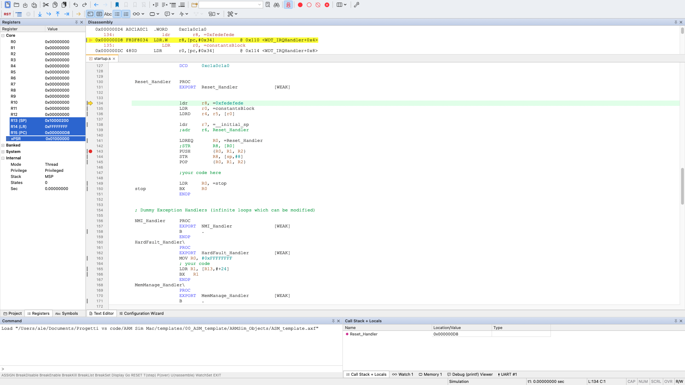

# ARM Sim

A µVision-style IDE and Cortex-M simulator for macOS.



ARM Sim is for students and developers who use Keil µVision on Windows and want to work on a Mac. You can open a `.uvprojx` project, build it and debug it in a simulator. The layout follows the µVision layout, so moving between the two tools is easy.

It has been tested mainly on the LPC1768 / LandTiger projects of the Politecnico di Torino computer architecture course.

> ARM Sim is an independent, clean-room project. It is not affiliated with Arm or Keil. It does not contain Keil code, tools or artwork. Keil and µVision are trademarks of Arm Limited.

## Features

### Projects
- Open µVision `.uvprojx` projects directly, including multi-target projects. Changes are saved back only when you edit something, in the same format µVision writes, so a diff shows only your edits.
- Read and write the `.uvoptx` debug options: breakpoints, Watch 1 and 2, Memory 1, "Run to main()" and the initialization file.
- Use CMSIS packs: Pack Installer, a device database read from `.pdsc`, the SVD System Viewer and the Configuration Wizard.

### Editor
- µVision layout and menus: project tree, editor tabs, toolbars with tool tips, Find / Replace / Find in Files, bookmarks, outlining and brace matching.
- Code completion: symbols of the last build, struct and union members after `.` and `->` (also on peripheral pointers such as `LPC_GPIO2->`), and the parameters of a function after `(`.
- **Edit ▸ Configuration** as in µVision: editor options, colors and fonts, user keywords, text templates and editable shortcut keys.

### Build
- C files are compiled with the Apple clang from the Xcode Command Line Tools, using flags equivalent to Arm Compiler 6.
- Keil armasm syntax is assembled with a native assembler. Its encodings match armasm on the course templates.
- The built-in linker creates an `.axf` file and an armlink-style `.map` file. Listings are written in the Keil `.lst` format.
- A small runtime is included: `__main`, `printf` through ITM, string functions, `malloc`, soft-float and `math.h`.

### Simulator
- Cortex-M0, M3 and M4 cores (Thumb and Thumb-2), with exceptions, NVIC and SysTick. About 65 million instructions per second on Apple silicon.
- On the M4: the FPv4-SP FPU and the DSP extension.
- LPC17xx peripherals: SC/PLL, GPIO, TIMER0-3, RIT, EINT, UART, ADC, DAC, PWM1 and CAN1/CAN2.
- LandTiger board: LEDs, buttons, joystick, potentiometer, speaker, TFT display and touch panel, as a 2D panel or a 3D board (see below).

### Debugger
- Windows: Registers, Disassembly, Memory, Watch with typed DWARF variables, Call Stack + Locals, Symbols (with the Special Function Registers), Command, Logic Analyzer (with Jump to Code), Code Coverage and peripheral windows.
- µVision debug scripts (`.ini`): `FUNC` and `SIGNAL` functions, `DEFINE BUTTON` (Toolbox window) and VTREGs such as `PORT2` and `AIN5`.
- "Start Debug Session with Keil Image" debugs an `.axf` built by µVision, without rebuilding it.
- Debugging through a GDB server instead of the simulator (see below).

### 3D LandTiger board

The LandTiger window has a **3D** tab that shows the board as the course's LandTiger Emulator does: the TFT shows the simulated display, LD4-LD11 light up, and you click the buttons, the joystick and the touch panel and drag the potentiometer. Drag the board to turn it and scroll to zoom.

The 3D models belong to the LandTiger Emulator (Politecnico di Torino, Gabriele and Federico Filipponi) and are not included in ARM Sim. Click **Import from LandTiger Emulator…** and choose your copy of `emulatore_v1.2.3.rar` (or the folder extracted from it). Only the model files are copied, into `~/Library/Application Support/ARM Sim/LandTiger3D`.

### Debug a board or QEMU

In **Options for Target ▸ Debug**, select **Use: GDB Server** and enter the host and port of the server. ARM Sim then loads the program, runs, steps and reads registers and memory on the target. Start the server first, for example:

```sh
# LandTiger (LPC1768) with a CMSIS-DAP probe; Load: OpenOCD
openocd -f interface/cmsis-dap.cfg -f target/lpc17xx.cfg

# Cortex-M3 in QEMU (generic ARMCM3 project); Host localhost, Port 1234, Load: Write memory
qemu-system-arm -M mps2-an385 -cpu cortex-m3 -nographic -S -gdb tcp::1234
```

This has been tested with QEMU only. A real board needs a debug probe supported by OpenOCD or pyOCD.

## Requirements

- macOS 14 or later.
- Xcode Command Line Tools, needed to compile C files: `xcode-select --install`. Xcode is not required.

## Install the release

1. Download `ARM-Sim-<version>-macOS.dmg` from [Releases](../../releases).
2. Open the DMG and drag `ARM Sim.app` to the `Applications` folder.
3. The app is not notarized, so macOS blocks the first launch. To allow it, do one of these:
   - Right-click the app, select **Open**, then select **Open** again.
   - Run `xattr -dr com.apple.quarantine "/Applications/ARM Sim.app"`.

The release build is for Apple silicon (arm64). On an Intel Mac, build the app from source.

### Updates

From version 0.3.0 the app updates itself from the GitHub releases. At launch, at most once a day, it
checks for a newer release. If there is one, it asks whether to install it. It then downloads the DMG,
checks it against the SHA-256 published by GitHub, replaces the app and relaunches it.
**Help ▸ Check for Update** checks at once. **Help ▸ Check for Updates Automatically** turns off the
check at launch. If the app cannot replace itself (for example, the folder is not writable), the
release page opens so you can install the update by hand.

## Build from source

```sh
./scripts/make-app.sh          # creates build/ARM Sim.app
./scripts/make-dmg.sh v0.3.0   # also packs it into build/ARM-Sim-v0.3.0-macOS.dmg
open "build/ARM Sim.app"
```

Other targets:

```sh
swift run -c release armsim-selftest   # self tests: assemble/compile snippets, run them, compare results
swift run armsim --help                 # command line simulator and assembler
```

## Command line tool

`armsim` runs an ELF, `.o` or `.bin` file in the simulator. It can also assemble Keil armasm sources:

```sh
armsim --cpu m4 program.axf
armsim --list out.lst --assemble startup.s startup.o
```

## Status

The main items still open are:
- Dedicated UART, RIT and ADC peripheral windows (they open the System Viewer for now).
- I2C and SSP0.
- Cortex-M7 double precision.
- Debugging tested on a real board.

## License

ARM Sim is source-available under the [PolyForm Noncommercial License 1.0.0](LICENSE). You may use, study and change it for any noncommercial purpose, including personal study, teaching and research.

Commercial use, including selling or redistributing the app for a fee, needs a separate license from the author.
